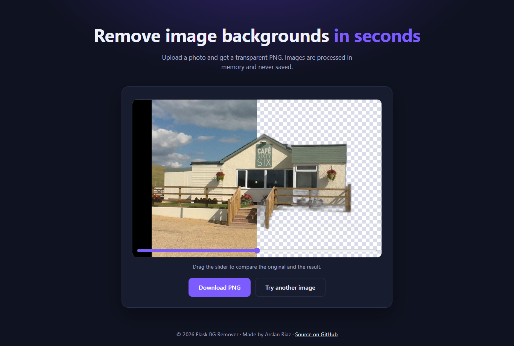

# Flask Background Remover

A small web app that removes image backgrounds and gives you a transparent PNG.
Built with Flask, [rembg](https://github.com/danielgatis/rembg) and Pillow.



## Features

- Drag and drop or click to upload
- Before / after slider to compare the result
- One-click PNG download
- Images are processed in memory and never saved to disk
- Upload limit (10 MB) and size cap (3000 px longest side) to keep it fast and safe
- The model loads once at startup, so repeat uploads are quick

## Run locally

Use Python 3.11 or newer (3.12 works with the pinned versions in `requirements.txt`).

```
python -m venv .venv
.venv\Scripts\python.exe -m pip install -r requirements.txt
.venv\Scripts\python.exe app.py
```

Then open http://127.0.0.1:5000. The first run downloads the background-removal
model (about 176 MB), so it needs an internet connection.

## Security

Requires Pillow 13.0.0 or newer (fixes the TIFF encoder heap overflow
GHSA-xcvg-w56q-r89m and related TIFF issues).

## License

MIT
